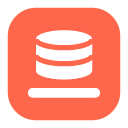
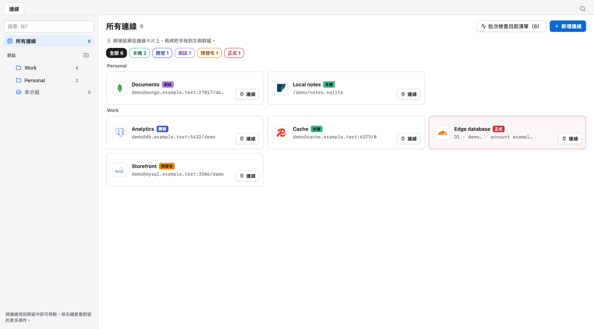
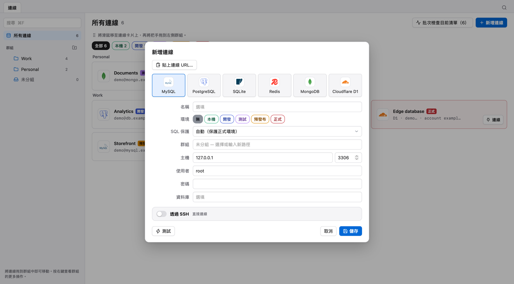

<p align="center"></p>

<h1 align="center">DBDock</h1>

<p align="center"><strong>データベースのための使いやすい作業空間。</strong><br />MySQL · PostgreSQL · SQLite · Redis · MongoDB · Cloudflare D1<br />macOS · Tauri 2 · Rust · React · v1.0.1</p>

<p align="center"><a href="README.md">English</a> · <a href="README.zh-CN.md">简体中文</a> · <a href="README.zh-TW.md">繁體中文</a> · 日本語<br />
<a href="https://dbdock.phpz.org/">公式サイト</a> · <a href="https://github.com/dofy/DBDock">GitHub</a> · <a href="https://github.com/dofy/DBDock/issues">Issues</a></p>

<p align="center">
  
  
  
  
  
</p>

DBDock は **MySQL、PostgreSQL、SQLite、Redis、MongoDB、Cloudflare D1** に対応するデスクトップデータベースクライアントです。SSH トンネル、接続グループ、環境タグ、Vim 対応エディターを備えています。

<p align="center"></p>

<p align="center"></p>

> スクリーンショットの接続はすべて架空のデモデータです。

## 機能

- **コマンドパレット**（⇧⌘P）：接続・グループ・クエリの作成、保存済み接続、テーマ・言語・Vim モードの変更などを検索して実行できます。上下キーと Enter で選択します。
- **接続管理**：カード表示、階層グループに対応。カードをクリックして選択・解除でき、複数選択も可能です。カードにマウスを重ねてハンドルを左側のグループへドラッグできます。環境タグでローカル、開発、テスト、ステージング、本番を区別できます。
- **一括ヘルスチェック**：表示中または選択した接続の必須項目を確認し、最大 4 件を同時にテストします。停止すると待機中のチェックを取り消し、実行中のチェックは完了まで続きます。カードには前回の結果が表示されます。編集後は結果に戻り、保存時は編集した接続の結果だけを消去します。存在しない SQLite ファイルは作成しません。
- **インポートとエクスポート**：DBDock、TablePlus、DBeaver、接続 URL に対応。パスワードは macOS キーチェーンに保存され、エクスポートは AES-256-GCM と Argon2id で暗号化できます。パスフレーズなしの場合は平文のため、慎重に保管してください。`rediss://` は未対応で、インポート時に拒否されます。
- **SSH**：ssh-agent、鍵ファイル、パスワードに対応。データベースのホスト名は SSH サーバー側で解決されます。ホスト鍵は事前に `~/.ssh/known_hosts` で信頼されている必要があります。新しいホストは OpenSSH で確認してください。SSH Hosts 管理画面は設定変更前にバックアップを作成します。トンネルは現在 ProxyJump に未対応です。
- **SQL**：ページ単位でデータを表示し、列で並べ替えたり、視覚フィルターを AND や OR で組み合わせたりできます。通常の接続では WHERE 句も入力できます。構造、インデックス、外部キーは個別のタブで確認できます。

  主キーを持つテーブルでは行の編集、追加、削除ができます。更新や削除時に元の行を照合し、競合があれば全件をロールバックして編集内容を保持します。現在読み込まれているクエリ結果は CSV または JSON にエクスポートできます。

  本番 SQL 接続でも通常の読み取りクエリはそのまま実行できます。書き込みやロックを行う SQL、影響が不明な SQL、テーブル変更のコミットは確認が必要です。接続設定で「閲覧のみ」を選ぶと両方の操作を無効にでき、再接続後に反映されます。

  MySQL と PostgreSQL はクエリの中止に対応します。テーブル表示は別接続を使用し、コミット済みのデータを表示します。

  ⌘T で SQL タブを新規作成し、⇧⌘W で現在のデータベースタブを閉じます。
  ⌘↵ で現在行または選択範囲、⇧⌘↵ で全体を実行します。ツールバーから SQL ファイルを保存・読込できます。最近の SQL は接続と選択中のデータベースごとにメモリに保持され、アプリ終了時に消去されます。⌃1–9 は上部タブ、⌘1–9 はデータベースタブを切り替え、修飾キーを押すと番号が表示されます。
- **Redis**：SCAN によるキーの参照、型と TTL の確認、データベースの切り替え、キーの削除、コマンド実行に対応。
- **MongoDB**：コレクションとインデックスの参照、フィルター、並べ替え、ページング、ドキュメントの編集、内蔵シェルに対応。SSH トンネルでは直接接続を使用します。
- **インターフェース**：ライト・ダークテーマと英語、簡体字中国語、繁体字中国語、日本語に対応。テーマと言語は既定でシステムに従い、設定から変更できます。Vim モード、ネイティブメニュー、オフラインヘルプを搭載。

## データの保存先

接続とグループは `~/Library/Application Support/xyz.phpz.app.dbdock/`、パスワード・トークン・SSH パスフレーズは macOS キーチェーンの `xyz.phpz.app.dbdock` サービス、画面設定はアプリの Web ストレージに保存されます。キーチェーンの許可はアプリの署名に紐づくため、通常はインストール済みアプリを使用してください。

## ビルドと開発

```bash
pnpm install
pnpm install:local  # /Applications/DBDock.app にインストール
pnpm tauri dev
```

ローカルインストールスクリプトは自己署名証明書 **DBDock Local Development** を使用し、再ビルド後もキーチェーンの許可を維持します。証明書のバックアップは iCloud Drive の `codesign-backup/` にあります。アイコンの元ファイルは `branding/dbdock-icon.svg` です。

`src-tauri` ディレクトリで `cargo test` を実行すると単体テストが走ります。実際のデータベースを使う統合テストは既定で無効です。使い捨てのテスト用データベースに対してのみ実行してください。コマンドと D1 の設定は[英語版 README](README.md#develop) を参照してください。

## ライセンス

MIT。詳細は [LICENSE](LICENSE) を参照してください。データベースのロゴは [Simple Icons](https://simpleicons.org)（CC0）から提供され、各名称はそれぞれの所有者に帰属します。
