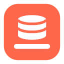
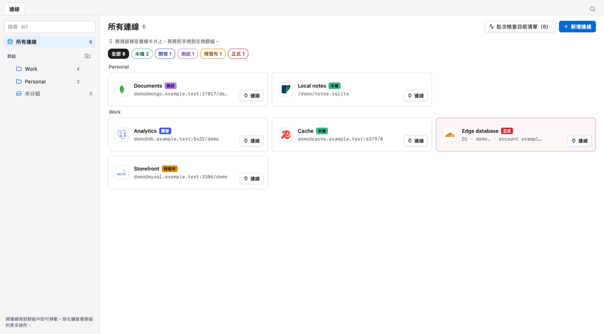
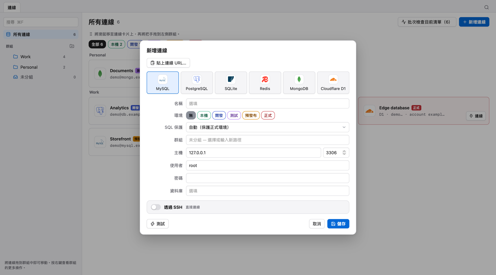

<p align="center"></p>

<h1 align="center">DBDock</h1>

<p align="center"><strong>给数据库找个顺手的家。</strong><br />MySQL · PostgreSQL · SQLite · Redis · MongoDB · Cloudflare D1<br />macOS · Tauri 2 · Rust · React · v1.0.1</p>

<p align="center"><a href="README.md">English</a> · 简体中文 · <a href="README.zh-TW.md">繁體中文</a> · <a href="README.ja.md">日本語</a><br />
<a href="https://dbdock.phpz.org/zh-Hans/">官网</a> · <a href="https://github.com/dofy/DBDock">GitHub</a> · <a href="https://github.com/dofy/DBDock/issues">Issues</a></p>

<p align="center">
  
  
  
  
  
</p>

DBDock 是一款桌面数据库客户端，支持 **MySQL、PostgreSQL、SQLite、Redis、MongoDB 和 Cloudflare D1**，内置 SSH 隧道、连接分组、环境标签和支持 Vim 的编辑器。

<p align="center"></p>

<p align="center"></p>

> 截图使用隔离的演示数据，所有连接均为虚构。

## 功能

- **命令面板**（⇧⌘P）：搜索并执行新建连接、分组、查询、连接数据库和切换主题、语言或 Vim 模式等操作；使用上下方向键和回车选择。
- **连接管理**：卡片视图和嵌套分组；点击卡片可选中或取消选中，支持多选。悬停卡片后可将手柄拖到左侧分组。使用环境标签区分本地、开发、测试、预发布和生产环境。
- **批量健康检查**：检查当前列表或所选连接的必填项，并最多同时测试 4 个连接。停止会取消等待中的检查，已开始的检查会继续完成；卡片显示上次结果。编辑后返回检查结果，保存时仅清除该连接的旧结果。SQLite 文件不存在时不会自动创建。
- **导入与导出**：支持 DBDock、TablePlus、DBeaver 和连接 URL。密码保存在 macOS 钥匙串；可使用 AES-256-GCM 和 Argon2id 加密导出。未加口令的导出为明文，请妥善保管。`rediss://` 暂不支持，导入时会被拒绝。
- **SSH**：支持 ssh-agent、密钥文件或密码；数据库地址从 SSH 服务器解析。主机密钥必须已在 `~/.ssh/known_hosts` 中验证，请先使用 OpenSSH 确认新主机。SSH Hosts 管理器编辑配置前会创建备份；目前隧道不支持 ProxyJump。
- **SQL**：浏览分页数据，按列排序，并用 AND 或 OR 组合可视化筛选条件。普通连接也可手写 WHERE。数据表提供结构、索引和外键标签页。

  具有主键的表可编辑、新增和删除行。更新或删除会核对原始行，发生冲突时回滚整批并保留待提交修改。查询结果可导出为 CSV 或 JSON，范围为当前已加载的结果。

  生产 SQL 连接可直接执行常规只读查询。写入、加锁或无法确定影响的 SQL，以及表格提交，仍需确认。可在连接设置选择「仅浏览」来禁用这两项操作，修改后重新连接。

  MySQL 和 PostgreSQL 支持取消查询，表格浏览使用独立连接，仅显示已提交的数据。

  ⌘T 新建 SQL 标签页，⇧⌘W 关闭当前数据库标签页。
  ⌘↵ 执行当前行或选区，⇧⌘↵ 执行全部脚本。工具栏可保存和载入 SQL 文件；最近 SQL 按连接和当前数据库保存在内存中，退出后清除。⌃1–9 切换顶部标签，⌘1–9 切换数据库标签，按住对应按键可显示数字。
- **Redis**：通过 SCAN 浏览键、查看类型与 TTL、切换数据库、删除键和运行命令。
- **MongoDB**：浏览集合和索引，过滤、排序、分页，编辑文档，并使用内置 Shell。SSH 隧道使用直连模式。
- **界面**：浅色与深色主题以及英文、简体中文、繁体中文、日语；主题和语言默认跟随系统，可在设置中更改。支持 Vim 模式、原生菜单和离线帮助。

## 数据位置

连接和分组存放在 `~/Library/Application Support/xyz.phpz.app.dbdock/`；密码、令牌和 SSH 口令存放在 macOS 钥匙串服务 `xyz.phpz.app.dbdock` 中；界面设置存放在应用的 Web 存储中。钥匙串权限与应用签名绑定，日常使用建议运行已安装的应用。

## 构建与开发

```bash
pnpm install
pnpm install:local  # 安装到 /Applications/DBDock.app
pnpm tauri dev
```

本地安装脚本使用自签名证书 **DBDock Local Development**，以便重建后继续使用钥匙串授权；证书备份位于 iCloud Drive 的 `codesign-backup/`。图标源文件为 `branding/dbdock-icon.svg`。

在 `src-tauri` 目录执行 `cargo test` 运行单元测试。真实数据库集成测试默认忽略，只能针对一次性测试数据库手动运行；具体命令和 D1 配置参见[英文 README](README.md#develop)。

## 许可

MIT，详见 [LICENSE](LICENSE)。数据库图标来自 [Simple Icons](https://simpleicons.org)（CC0）；相关名称属于各自所有者。
