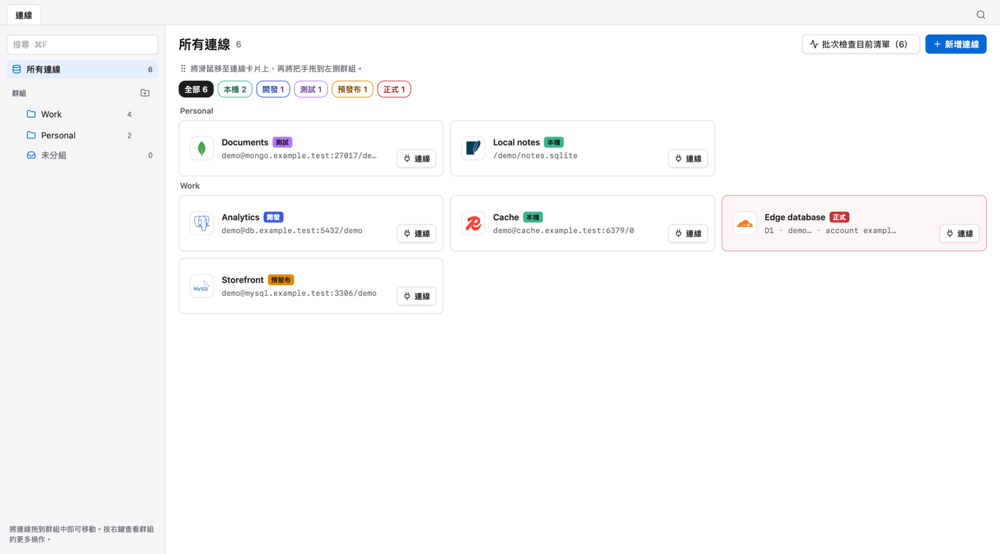
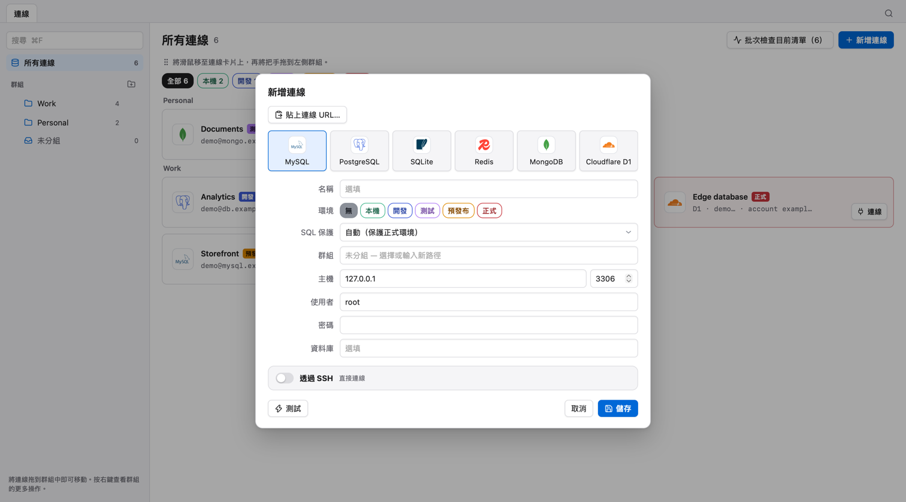

<p align="center"></p>

<h1 align="center">DBDock</h1>

<p align="center"><strong>為資料庫打造順手的工作空間。</strong><br />MySQL · PostgreSQL · SQLite · Redis · MongoDB · Cloudflare D1<br />macOS · Tauri 2 · Rust · React · v1.1.1</p>

<p align="center"><a href="README.md">English</a> · <a href="README.zh-CN.md">简体中文</a> · 繁體中文 · <a href="README.ja.md">日本語</a><br />
<a href="https://dbdock.phpz.org/zh-Hant/">官網</a> · <a href="https://github.com/dofy/DBDock">GitHub</a> · <a href="https://github.com/dofy/DBDock/issues">Issues</a></p>

<p align="center">
  
  
  
  
  
</p>

DBDock 是桌面資料庫用戶端，支援 **MySQL、PostgreSQL、SQLite、Redis、MongoDB 和 Cloudflare D1**，內建 SSH 通道、連線群組、環境標籤及支援 Vim 的編輯器。

<p align="center"></p>

<p align="center"></p>

> 截圖使用隔離的示範資料，所有連線均為虛構。

## 功能

- **命令面板**（⇧⌘P）：搜尋並執行新增連線、群組、查詢、連線資料庫，以及切換主題、語言或 Vim 模式等操作；使用上下方向鍵和 Enter 選擇。
- **連線管理**：卡片檢視與巢狀群組；點擊卡片可選取或取消選取，並支援多選。將滑鼠移至卡片後，可將把手拖到左側群組。使用環境標籤區分本機、開發、測試、預發布及正式環境。
- **批次健康檢查**：檢查目前清單或所選連線的必填項目，最多同時測試 4 個連線。停止會取消等待中的檢查，已開始的檢查會繼續完成；卡片顯示上次結果。編輯後返回檢查結果，儲存時只清除該連線的舊結果。SQLite 檔案不存在時不會自動建立。
- **從 URL 新增連線**（⇧⌘I）：將單條 URL 填入表單，儲存後建立連線。
- **匯入與匯出**：支援 DBDock、TablePlus、DBeaver 和連線 URL。密碼儲存於 macOS 鑰匙圈；匯出可使用 AES-256-GCM 和 Argon2id 加密。未設定密語的匯出為明文，請妥善保管。`rediss://` 尚未支援，匯入時會被拒絕。
- **SSH**：支援 ssh-agent、金鑰檔案或密碼；資料庫位址由 SSH 伺服器解析。主機金鑰必須已在 `~/.ssh/known_hosts` 中驗證，請先透過 OpenSSH 確認新主機。SSH Hosts 管理器編輯設定前會建立備份；通道目前不支援 ProxyJump。
- 按 ⌘K 搜尋連線、目前工作階段的資料庫和結構描述，以及目前結構描述的資料表。收藏和最近存取儲存在本機。切換 MySQL 和 PostgreSQL 資料庫會開啟或重用獨立的工作階段。
- **SQL**：瀏覽分頁資料、依欄位排序，並用 AND 或 OR 組合視覺化篩選條件。一般連線也可手寫 WHERE。資料表提供結構、索引和外鍵分頁。

  有主鍵的資料表可編輯、新增和刪除列。更新或刪除會核對原始列，發生衝突時回復整批並保留待提交變更。查詢結果可匯出為 CSV 或 JSON，範圍為目前已載入的結果。

  正式 SQL 連線可直接執行一般唯讀查詢。寫入、鎖定或影響不明的 SQL，以及資料表提交，仍需確認。可在連線設定選擇「僅瀏覽」停用這兩項操作，變更後請重新連線。

  MySQL 與 PostgreSQL 支援取消查詢，資料表瀏覽使用獨立連線，僅顯示已提交的資料。

  可在應用程式中建立資料表、調整欄位，執行前可預覽 SQL。資料表支援 CSV 和 JSON 匯入匯出，匯入前可預覽並對應欄位，也可匯出整張資料表。

  ⌘T 新增 SQL 分頁，⌘L 聚焦現有的 SQL 編輯器，⌘I 美化選取內容或整個編輯器，將關鍵字大寫並依資料庫方言為識別字補引號。⌘W 關閉目前的子分頁，全部關閉後再按可確認關閉連線。⌥⌘W 確認後直接關閉連線。
  ⌘↵ 執行選取內容或游標所在的完整陳述式，⇧⌘↵ 執行全部腳本。工具列可儲存和載入 SQL 檔案，也可搜尋、預覽及載入查詢記錄。查詢記錄依連線及工作階段的資料庫保存在記憶體中，結束後清除。⌃1–9 切換頂部分頁，⌘1–9 切換資料庫分頁，按住對應按鍵可顯示數字。

  **依上下文補全 SQL**支援 CTE、子查詢與跨結構描述的資料表名稱和欄位名稱，並依編輯器工作階段的目前資料庫或搜尋路徑提供建議。在 `JOIN … ON` 後會提示已宣告的外鍵聯結條件，支援複合外鍵。PostgreSQL 和 MySQL 也會提示已宣告的 `ENUM` 值。

  **視覺化執行計畫**可查看選取內容或游標所在陳述式的執行計畫。展開節點可檢查索引、條件和預估列數，也可查看原始輸出。「執行計畫」預設執行 `EXPLAIN`，SQLite 和 D1 使用 `EXPLAIN QUERY PLAN`。PostgreSQL 和 MySQL 8.0.21 或更新版本提供獨立的「分析查詢…」，確認後會實際執行陳述式並顯示實際列數和耗時。
- **Redis**：透過 SCAN 瀏覽鍵、檢視類型與 TTL、切換資料庫、刪除鍵及執行命令。
- **MongoDB**：瀏覽集合與索引，篩選、排序、分頁、編輯文件，並使用內建 Shell。SSH 通道使用直接連線模式。
- **介面**：淺色與深色主題，以及英文、簡體中文、繁體中文、日文；主題與語言預設跟隨系統，可在設定中更改。支援 Vim 模式、原生選單和離線說明。

## 資料位置

連線與群組儲存在 `~/Library/Application Support/xyz.phpz.app.dbdock/`；密碼、權杖和 SSH 密語儲存在 macOS 鑰匙圈服務 `xyz.phpz.app.dbdock`；介面設定儲存在應用程式的 Web 儲存空間。鑰匙圈權限與應用程式簽章綁定，日常建議使用已安裝的應用程式。

## 建置與開發

```bash
pnpm install
pnpm install:local  # 安裝至 /Applications/DBDock.app
pnpm tauri dev
```

本機安裝指令使用自簽憑證 **DBDock Local Development**，讓重新建置後仍能使用鑰匙圈授權；憑證備份位於 iCloud Drive 的 `codesign-backup/`。圖示來源為 `branding/dbdock-icon.svg`。

在 `src-tauri` 目錄執行 `cargo test` 可執行單元測試。真實資料庫整合測試預設忽略，僅應對一次性測試資料庫手動執行；命令和 D1 設定請見[英文 README](README.md#develop)。

## 更新記錄

### 1.2.0 — 2026-11-24

- 新增簽章更新。可在**設定 → 更新**中關閉自動檢查或手動檢查。安裝由使用者確認，重新啟動時會檢查未儲存的變更。
- 貼上單筆連線 URL 時，先開啟可編輯的連線草稿，再由使用者儲存。
- 拆分連線、工作階段、選單及 SQL 命令模組，並擴充 WebKit 回歸測試。

### 1.1.1 — 2026-11-19

- 修正在中文輸入法中按 Enter 確認英文時，命令面板提前執行命令的問題。
- 命令面板快捷鍵採用較大的等寬字型鍵帽，並增加按鍵符號間距。
- 修正 macOS 上用滑鼠點選「分析查詢…」時未開啟確認對話框的問題。

### 1.1.0 — 2026-11-18

- 新增視覺化執行計畫和依上下文補全 SQL。
- 新增建立資料表、結構編輯、資料匯入匯出和正式環境寫入保護。
- 新增快速切換、收藏、最近存取和可搜尋的查詢記錄。
- 修正 SQL 編輯器底部的補全浮層。建議現在能完整顯示，浮層容器也不會遮住編輯器、工具列和結果區。

## 授權

MIT，詳見 [LICENSE](LICENSE)。資料庫圖示來自 [Simple Icons](https://simpleicons.org)（CC0）；相關名稱屬於各自所有者。
